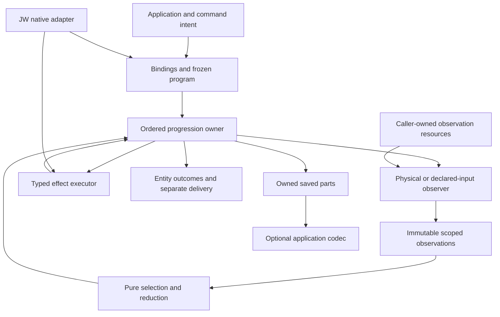

# Composable tree execution

## Reading map

- [Design position](#1-design-position) and [component boundaries](#2-components-and-dependency-direction)
- [Bindings and facts](#3-bindings-coordinates-and-facts), [inspection](#4-inspection-and-assessment), [typed work](#5-typed-work-claims-and-dispatch)
- [Progression](#6-one-progression-owner), [construction and saved parts](#7-construction-saved-parts-and-failure)
- [Runtime resources and dirent buffers](#resource-control-and-dirent-buffers), [name ownership](#9-name-ownership-and-fact-lifetime)
- [Generated inputs](#10-generated-content-and-virtual-discovery), [specialized recursion](#11-specialized-recursion-and-what-it-can-skip), [source-to-many](#12-source-to-many-composition)
- [JJ/Git integration](#13-jj-archive-and-receiving-workspace), [persistence](#14-persistence-and-compatibility)
- [Parallelism and memory](#15-parallelism-and-bounded-memory), [next slices and checks](#16-concrete-next-work-and-proof-obligations), [open decisions](#17-open-decisions-with-a-narrow-boundary)

## 1. Design position

I would build this around **one physical observation substrate, a small typed work
protocol, and an optional caller-owned progression engine**. Existing comparison
and coarse synchronization remain useful compositions. The new capability is that
an application can assemble work, advance it at explicit boundaries, retain its
unfinished state, and reconstruct the executable components in another process.

The primary architectural separation is:

```text
what is present        → observations
what is wanted         → desired inputs and policy
what is selected       → goals, dependencies and target claims
what advances          → one ordered driver
what performs I/O      → observers and executors
what survives a pause  → owned future state
what accelerates a run → replaceable runtime resources
```

These categories must not be collapsed into an add/change/remove record, an opaque
action payload, or a shared mutable context object.

This is my concrete design draft after the flight. It chooses mechanisms and
ownership below, while marking the remaining product choices explicitly. The
current [core specification](/README.md), [sync specification](/sync/README.md),
and delivered examples retain their documented behavior. Proposed type names in
this draft are interface sketches, not claims that those APIs already ship.

### Decisions I am taking in this draft

1. Keep the core read-only. Reuse immediate inspection rather than replace the
   comparison walker with a universal scheduler.
2. Use caller-typed work and ordinary dispatch first. Versioned descriptors adapt
   external/stored jobs into that same checked path.
3. Give one driver ownership of each expanded recursive edge and of accepting its
   results. Executors do not secretly recurse through those edges again.
4. Represent unfinished goals, phases, child suffixes and component state explicitly.
   Do not save an effects history or serialize live runtime objects.
5. Keep physical comparison, desired satisfaction and coverage separate.
6. Make performance resources caller-owned and shareable. Their tuning can change
   without changing a saved program's meaning.
7. Treat native JJ/Git operations as consumer work around ordinary transfer. Keep
   archive source, repository owner and receiving identity distinct.
8. Make the next native landing small: explicit joint creation, owned-colocated
   reseed on its existing no-adoption route, then the chosen creation default.

## 2. Components and dependency direction



The roles have concrete owners:

| Role | Owns | Does not own |
| --- | --- | --- |
| Physical observer | Enumeration, required stat/readlink/content observation, transient backend resources | Deletion policy, native graph intent or completion |
| Program | Frozen semantics, lowering, child selection, desired goals, folding and finish derivation | Hidden filesystem I/O inside pure decisions |
| Driver | Active frames, phase transitions, pending request, acknowledgment and accepted aggregates | Filesystem preparation or native command internals |
| Executor | The selected unit's actual I/O, resources and returned result | Advancing another component's child cursor |
| Finisher/component | Its declared result computation and required saved data | Implicit exactly-once external delivery |
| Resource owner | Buffer reuse, execution facilities and optional caches | The meaning of desired results or source validity |
| Codec adapter | Owned data representation and compatibility checks | Runtime reconstruction by serializing pointers or closures |
| Native adapter | Repository/workspace bindings, revisions, native metadata and native finish | General directory-copy policy |

The current package split stays meaningful:

- **`diff-dirs`** owns physical observation, comparison and pure steering. No
  mandatory codec, native repository client or effect executor enters it.
- **`diff-dirs-sync`** owns filesystem mutation and its existing coarse APIs.
  A production step adapter adds nonrecursive units here when that use case is
  selected; ordinary sync need not become resumable to remain usable.
- **The caller owns progression initially**, as `examples/walk` demonstrates.
  If it is promoted for multiple production consumers, the target home is a small
  optional `walk/` package containing the progression machine and semantic parts,
  not a filesystem/runtime/codec framework. It does not depend on JW or require
  sync. A sync adapter and a JW composite executor supply their own work types.
- **Applications own transport schemas.** An extracted driver exposes
  `into_parts`/`from_parts`; the application projects those parts into its own
  versioned wire DTO. A shared transport adapter can follow actual reuse. Moving
  a runtime vector to a deque must not accidentally redefine persisted bytes.

This extraction is not a prerequisite for the native colocation work. The
delivered examples remain the implementation home until a production consumer
actually needs the shared control component.

For that extraction, the dependency direction is concrete: the small `walk`
controller is generic over query/observation, goal/reply, node and program-state
data, with a standard-library-only default. It does not import `DirectoryPlan` or
filesystem mutation. A filesystem program/adapter imports `diff-dirs`; an optional
sync step adapter can import the controller. JW composes filesystem and native
goals. Neither the read-only core nor the controller imports JW. One `Program`
groups lowering, acceptance, folding and finish behavior; its methods are not a
separately registered plugin for every noun in the component table.

## 3. Bindings, coordinates and facts

### Four coordinates

Keep these distinct even when ordinary copying gives them equal suffixes:

1. **Logical coordinate:** the entity the program is discussing.
2. **Physical input coordinate:** where a physical observation or content read occurs.
3. **Final target coordinate:** where the intended result belongs.
4. **Private preparation coordinate:** an executor's temporary location.

Policy sees logical/final coordinates. A staging directory is not silently passed
to a policy as the destination. A root identifier resolves through an explicit
binding; it is not proof that two roots denote independent physical namespaces.

Bindings validate syntax and component compatibility separately from performing
operation-specific filesystem binding. Ordinary comparison requires two real
directory roots. Initialization can bind an absent target with a valid parent.
Those are different operations, not exceptions hidden inside one path lookup.

### Observation states

A physical side has **presence**, and a present side has **available facts**:

```rust,ignore
enum Presence { Absent, Present }
enum Available<T> {
    NotRequested,
    Unknown,
    Known { value: T, origin: FactOrigin },
}
```

An acquisition failure is an error at its declared observation boundary, not an
`Absent` or `Equal` value. Policy exclusion is coverage, not source absence.
Known unsupported kind is positive information; it is not an unknown name.

`FactOrigin` identifies enumeration hints, structural-root observation, admitted
metadata/readlink, or another actual acquisition. Generated desired attributes
are represented separately. There is no constructor that makes invented
`std::fs::Metadata` look like an observed source file.

The normal physical predicate remains **type, size and exact supported mtime**
for regular files, and literal native link spelling for symlinks. Directory
timestamps do not certify descendants. A future optional comparison method must
name its predicate and incomplete/unknown coverage; it does not silently strengthen
or replace that baseline.

### Desired inputs

An application can want something not present in the source listing:

```rust,ignore
enum Content<R> {
    Physical { input: InputId, relative: NativePath },
    Bytes(Vec<u8>),
    Recipe(R),
}
struct DesiredFile<R> {
    logical: LogicalId,
    target: Target,
    content: Content<R>,
    attributes: DesiredAttributes,
    satisfaction: SatisfactionRule,
}
```

Desired mode is an instruction, not observed source mode. A recipe is not a file
stat key. Output-affecting parameters, interpreter version and required inputs
belong to the desired meaning. Unknown target satisfaction stays unknown; the
program can request more observation, install unconditionally, or decline.

This sketch describes a regular file. Symlink goals carry literal native link text;
directory goals carry container/child/finish obligations. Metadata has an explicit
profile: required permissions, mtime or other supported attributes. “Copy metadata”
is not an unspecified promise to preserve ownership, ACLs, xattrs and every platform
field. Unsupported required attributes must remain visible. The current sync
contract and the byte-only specimen intentionally have different profiles.

## 4. Inspection and assessment

The existing immediate-directory seam remains the useful unit:

```text
complete present-side listings
  → ordered native-name union
  → early admission
  → explicitly demanded observations
  → pure assessment
  → validated immediate work and child selection
```

The observer performs I/O. Assessment consumes supplied facts and frozen context.
It may run more than once or speculatively; it cannot use callback invocation
count as progress. A decision needing an earlier accepted child result receives
that result as a new frozen input at the appropriate ordered position.

I would add narrow fact demand alongside full-demand compatibility, not infer
demand by watching which accessor a callback happens to call:

1. Names/hints can terminate preservation immediately.
2. Resolve missing kind only when shape matters; if stat supplied it, retain that
   same metadata for later attribute demands.
3. Acquire the union of comparison and declared policy demands.
4. Acquire remaining execution inputs before the affected effect unit.

The first vocabulary can be `Kind`, `Attributes`, `LiteralLink`, and explicit
content/satisfaction observation. Splitting attributes into size/mtime/mode flags
does not imply the OS offers proportionally cheaper stat calls.

Existing full-fact visitors keep their payload and precedence. Moving an
overrideable late retain decision into terminal early exclusion is a semantic
change. Likewise, a narrow effect program may acquire facts per leaf and fail
after an earlier write, but must not advertise the old whole-batch error behavior.

When comparison is omitted by a specialized operation, the result is
**NotAssessed**, not Equal and not Unsupported. Selected work can exist in a
physically clean directory. The work driver consumes complete immediate plans
directly; the legacy difference-only iterator retains its useful silent-clean
reporting projection.

## 5. Typed work, claims and dispatch

The first reusable protocol is typed application work. These types belong to the
application or its effect adapter, not to the generic controller:

```rust,ignore
enum Work<G> {
    Filesystem(FilesystemGoal),
    Application(G),
}
struct Selected<G> {
    goal: G,
    claims: TargetClaims,
    position: DependencyPosition,
}
```

This is not a globally growing enum of every possible operation. The application
chooses `G` and its executor. The existing physical `Action` stays useful inside
its physical-plan protocol; it is not stretched into a universal job format.

At a stored/external boundary, a finite descriptor
`{kind, version, parameters}` decodes into typed work and the same validation path.
Known fields are typed. Inert annotations may be open KVs, but an annotation that
changes output, routing or dependencies must become part of the semantic payload.
Unknown meaning/version is an explicit refusal, not fallback to a similarly named
handler. No global plugin discovery is required.

### Target claims

A handler's meaning determines its affected region. A supplied claim must match
that meaning; an opaque KV payload does not grant arbitrary writes. Distinguish
leaf writes, container creation, exclusive subtree replacement/removal, and
reservations for later output. Native handlers additionally own their native
semantic footprint: changing tracked membership can affect files beyond the
metadata file physically written.

For the first general mapping surface I would support:

- identity/prefix mappings into disjoint owned regions;
- finite predeclared destinations validated before their effects;
- explicit incremental mappings only with a retained claim index and a documented
  late-conflict boundary.

The default conflict response is refusal for that declared unit. Priority, merging
or coalescing is a separate program policy. Traversal order is never an accidental
winner. A previous generated output is actual target state, not another producer.

Reservations remain while later discovery could compete. They may be reconstructed
from a fixed descriptor instead of stored repeatedly. Unrestricted mappings can
require O(number of destinations) claim state; that is future constraint state,
not an effects ledger, but the simple directory-copy case should not pay for it.

Leaf mutation defaults to preparation plus replacement, preserving the existing
source/alias isolation model. A future in-place content or metadata goal needs an
explicit alias-write contract: chmod or writes through a hardlinked inode can
affect another name. It is not an invisible optimization of a replace-one-name
operation. Directory permission scopes remain executor-owned and restore their
declared original/final mode at the chosen boundary.

## 6. One progression owner

An expanded directory has semantic phases:

```text
before obligations → assessment → ordered children → finish obligations → close
```

A leaf can be one settlement unit; do not invent a directory assessment for it.
Initial before obligations come from binding or the parent's selected child
descriptor. For example, an absent target directory must be ensured before the
chosen paired child assessment. Other programs can choose a different explicit
observation/materialization sequence.

The controller distinguishes **atomic nodes** (one declared goal, then closure)
from **branch nodes** (entry/observation, children and finish). A native command can
be atomic just as a file install can; filesystem names are not baked into the
controller's node type. A composite handler either returns child descriptors to
this driver or declares one opaque atomic unit. It does not do both.

The driver owns:

- the active stack;
- each frame's accepted local result;
- its unclosed child suffix and accepted child aggregate;
- its pending before/finish work and coverage;
- one outstanding request and the state needed by components.

The semantic parts layout is:

```text
Saved
  interpretation: schema + bindings + program/component descriptors
  driver: active frames + pending request + next ticket + terminal result
  components: typed behaviorally necessary component data

Frame
  immutable node identity/context + atomic/branch kind
  phase + unfinished entry/finish continuation
  accepted local result + unclosed child suffix + accepted child aggregate
  coverage

Pending
  ticket + observation/effect kind + frozen query/goal inputs + optional block
```

Use typed phase variants where practical to exclude impossible combinations.
Restore checks root/edge relationships, ordered suffixes, phase/data compatibility,
pending identity and component interpretation. Internally trusted transitions need
only validate their affected delta; they need not rewalk every saved frame after
every leaf. Application-specific native tips or mapping state have a named owner
in frame/component data, not an untyped shared context bag.

The active child remains at its parent's front until closure. Only closure removes
that edge and folds the result. Executors never recurse through an edge also
expanded by the driver. Existing opaque recursive sync remains valid when that
coarser return is the desired boundary.

### Requests and acceptance

```rust,ignore
enum Request<Q, G, R> {
    Observe { ticket: Ticket, query: Q },
    Execute { ticket: Ticket, goal: G },
    Done(R),
}
```

Requests own semantic data, not borrows into a plan or staging guard. Repeated
polling returns the same unresolved request. The host may execute it itself or
use a bound convenience runtime. Acknowledgment checks ticket, phase and result
kind. Contribution comes from the selected program, not an arbitrary caller-supplied
count. External acknowledgments are trusted caller evidence, not cryptographic
proof of filesystem effects.

Acceptance performs fallible arithmetic/validation before committing the state
transition. The prototype clones candidate state for clarity. A production driver
should prepare just the affected frame/parent/component update, then commit it;
cloning a wide frontier after every leaf is not the desired implementation.

I would also make the production convenience dispatcher consume a **pending ticket**
and execute the driver's stored goal. That avoids treating a caller's cloned payload
as the authoritative request. An external/manual host still obtains an owned intent
and returns a trusted typed reply. If an API echoes the full request, it must check
that it matches pending state, as the specimen does. Neither form needs a second
dispatcher-owned progress cursor.

“Fold once” means once in this advancing lineage. Old or forked saved states can
repeat work. No consumed-ticket history or cross-process deduplication service is
part of the architecture.

### Budgets and results

The default step budgets count attempted immediate assessments and closed effect
units separately. Zero is valid. Stop at the next required exhausted class rather
than jumping over a dependency. Pure pushes/folds may drain; an effectful finish
cannot run as a free stack pop.

Label the granularity of opaque work. One native `sparse reset`, command, whole
subtree application or large file copy can do substantial work. An attempt-count
limit is not a byte, latency, memory or syscall bound.

Keep these outputs distinct:

| Output | Meaning |
| --- | --- |
| Observed differences | What the declared physical predicate observed |
| Selected goals | What the program intends to settle |
| Accepted results | What this advancing control state has accepted |
| Invocation writes | Observed installations/creations, not a staging-syscall census |
| Coverage | Traversed/proven, preserved, or abandoned incomplete within a domain |
| Entity completion | Declared local/child/finish obligations closed |
| Delivery | A separate sink has accepted or published output |

An exact-count reducer needs actual counts or sufficient supplied aggregate data.
Skipping a subtree because satisfaction is known cannot invent its descendant count.

## 7. Construction, saved parts and failure

The delivered builder already demonstrates the required shape:

```rust,ignore
let mut run = cursor()
    .parts(StartParts::Fresh(bindings))
    .inspector(FullInspector)
    .executor(ByteExecutor)
    .program(DesiredCopy::v1())
    .manifest(Manifest::builder().label("A".to_owned()).build())
    .build()?;
run.bind_filesystem()?;
run.drive(Limits { assessments: 2, effects: 2 })?;
let saved = run.into_saved()?;
```

This is actual `examples/walk` usage. The production-facing design keeps the same
separation: constructors receive components; restoration receives owned parts and
new implementations; neither is a hidden factory selecting global runtime state.

### What is saved

The application-owned `Saved` value contains:

- schema and program/parameter interpretation;
- logical bindings and source/target coordinates needed for future work;
- active frame phases, unclosed children, accepted local/aggregate data and coverage;
- pending goal, ticket and block information;
- component state, such as the manifest's next accepted ordinal;
- generated recipe inputs or chosen body/reference needed by a pending goal;
- native intent/tips only when a native component actually needs them.

It does not contain open descriptors, borrowed dirents, thread pools, private Rust
layouts, full old `DirectoryPlan`s or a catalog of completed effects. Selected
desired metadata may be saved as ordinary typed input; this does not turn a saved
observation into fresh evidence. Otherwise reacquire the unresolved operation's
needed facts at execution.

Performance settings are runtime inputs, not frozen program meaning. Restoring with
a different dirent buffer size or idle-cache capacity is valid. Changing a generator
label, target binding, deletion policy or satisfaction rule requires a new run or
an explicit semantic migration/replan; it is not mere resource tuning.

| Frozen meaning | Rebindable execution controls |
| --- | --- |
| Source/binding identity; desired domain; mirror/update/seed authority; comparison/satisfaction predicate; mapping and generation parameters; native snapshot/parent intent; result-sensitive ordering | Buffer sizes and idle retention; supplied worker pool/admission limits within the declared ordering contract; invocation budgets; optional recomputable caches |

An observer/backend change that alters available facts or policy interpretation is
not automatically a performance-only switch. Validate the required component
capabilities separately from freely changing its scratch-buffer settings.

### Failure and pause

Failure leaves actual effects. The useful continuation retains the unresolved goal,
not a conclusion that the failed operation did nothing. Retry observes enough
current state to settle that goal. An already-created directory or installed file
can therefore become a no-write success. Skip abandons its declared scope, marks
affected ancestors incomplete immediately, and leaves visible effects alone.

Normal voluntary pause requires represented future state and joined work. Close
temporary preparation and permission scopes; discard/reconstruct runtime caches.
A deliberately persistent generated body is data with an explicit owner and
lifetime, not a serialized open stream. There is no rollback, recovery boundary,
effects history or exactly-once promise.

A generic driver does not know whether an arbitrary native mutation is safely
repeatable. An unacknowledged `jj new D` needs native-specific examination or
explicit disposition; blindly repeating it may allocate another change.

<a id="resource-control-and-dirent-buffers"></a>

## 8. Resource control and dirent buffers

This section is a design contract. The work is recorded in
`diffdir-tree-observe-dirent-tuning` and `diffdir-tree-observe-dirent-pool`; this
writing pass changes no enumeration code.

### Selected initial policy

| Setting | Initial meaning |
| --- | --- |
| Native read buffer | **64 KiB** requested read length |
| Idle pool retention | **Up to 16 buffers**, allocated lazily |
| Excess concurrent reads | Allocate temporary storage rather than wait for a cache slot |
| Reconfiguration | Runtime-adjustable controls; new borrows observe the new policy |
| Automatic tuning | Not part of the initial mechanism |

Sixteen is an **idle retention limit**, not sixteen preallocated buffers and not
a semaphore limiting readers. A warm cache of sixteen ordinary 64 KiB buffers
holds 1 MiB of buffer capacity. A count-only limit permits larger idle capacity
after growth. Active leases, metadata batches, name storage and execution frontiers
are separate memory owners.

I would also give the cache a retained-capacity byte ceiling, initially derived
from count × preferred size (1 MiB at these defaults), with an explicit override.
This is a design recommendation, additional to the human-selected starting values.
Count and byte ceilings are both checked on return; zero can disable retention.

The proposed controls are a value object, published as one coherent update:

```rust,ignore
struct DirentSettings {
    read_bytes: NonZeroUsize,                 // default: 64 KiB
    max_idle_buffers: usize,                  // default: 16
    max_idle_capacity_bytes: Option<usize>,   // None: count × read_bytes
    error_growth_ceiling: Option<NonZeroUsize>, // None: max(read_bytes, 128 KiB)
}
```

`ObservationResources::reconfigure_dirent` returns the effective settings and
generation, or a configuration/backend error. A caller can keep that control
handle while a constructed walker uses its cloned resource handle. These are
proposed APIs; the current reader still has its hard-coded 8 KiB allocation.

### Owner and API boundary

`ObservationResources` is a caller-owned shareable handle. Walkers, direct inspectors,
audits and sync recursion receive it through their owning observer/binding. The
same handle shares a cache; separate handles have independent budgets. There is
no hidden process-global or per-worker pool multiplying the advertised limit.

Existing convenience entrypoints create one default resource owner at their outer
operation boundary. They do not create a new pool per directory. A one-shot free
inspection call can use a local owner; repeated calls use the bound inspector or
an explicit resource-taking entrypoint. Existing `WalkOptions` need not acquire
an `Arc` merely to carry resources: keep value settings and live resource ownership
distinct, and expose them through construction.

The first controls are explicit, coherent updates to the handle's policy. CLI/config
resolution occurs outside core and supplies initial settings. Embedded callers can
reconfigure between or during operations. No environment lookup occurs per entry.

### Lease contract

1. Borrow captures a validated policy generation and selects a suitable idle buffer
   under a short cache lock. Prefer a small sufficient capacity; grow or allocate
   outside the lock when necessary.
2. The lease owns its buffer and exposes only the requested read slice. A cached
   128 KiB allocation does not silently make a new 64 KiB read request use 128 KiB.
3. Directory I/O and bounded growth never hold the cache lock. A missing idle buffer
   does not block a worker waiting for another reader to finish.
4. Return happens after the native iterator and every borrow into that scratch
   buffer have ended, on EOF and error paths. Reuse starts with fresh iterator
   initialization; bytes left from a prior read are not entries in the new read.
5. Return consults **current** retention settings. An active lease survives a size
   reduction/cache disable; on return it is retained only if the new policy permits
   its capacity. Otherwise its allocation is released.
6. Dropping the resource owner does not invalidate an active lease. Its eventual
   return may simply release the buffer if the cache no longer exists.

A mutex plus a small idle vector is sufficient initially. This is storage reuse,
not a scheduler. The existing frontier's admission limits own concurrent work;
they must not acquire a second hidden permit dependency inside listing.

### Configuration changes and growth

Policy updates are validated and published atomically as a coherent value. Existing
reads finish under their captured size/growth policy; future borrows use the new
one. Idle entries can be evicted to fit new retention limits. This changes only
cache storage, not filesystem state or traversal results.

Validate positive read length, representable backend sizes, a growth ceiling at
least as large as the requested read, and checked capacity-budget arithmetic.
Zero retained count/bytes disables caching rather than disabling directory reads.
Do not silently clamp an invalid caller request and report the requested value as
the effective one.

Keep **configured read size**, **allocated capacity**, and **bounded EINVAL growth**
separate. The current 128 KiB ceiling exists to stop retrying a possibly unrelated
EINVAL forever; it is not a fundamental maximum for aggregating many dirent records
in one syscall. A useful default growth ceiling is `max(requested_read_size,
128 KiB)`, with checked, finite explicit overrides. Larger configured read sizes
must not be rejected merely because an individual record uses a u16 length.
Retain the native iterator's alignment handling and same-descriptor continuation
when growing. No restart-from-directory-root or duplicate publication is allowed.

Tuning may affect costs and resource failures, but not names, ordering, equality or
coverage. Switching observer semantics is a different binding decision. Current
native enumeration is Linux/`native-dirent` gated and needs the existing nightly
support; the CLI currently does not forward that feature. Expose actual backend
activation and reject explicitly requested unsupported controls rather than
pretending std enumeration used them.

### What this pool does not own

The scratch buffer is not a name arena, pending-child list or source-fact cache.
Current entries copy their names, so a buffer can return immediately after that
side's enumeration, even while parent handles remain for later metadata. A paired
listing can reuse it for the other side.

A future zero-copy raw-batch representation would prolong the lease until all
views are released. It cannot return the same storage to the pool while a plan or
child still borrows its names. Prefer a separate compact owned name arena and
promotion of sparse survivors; the measurements show why pinning an entire batch
for one child is expensive.

Metrics distinguish borrows, reuse, allocations/growth, discarded returns, idle
capacity, active leases and requested read length. Count actual refill behavior
only where the backend exposes it; do not infer exact returned syscall bytes from
buffer capacity. Pool byte limits are capacity bounds, not total RSS bounds.

## 9. Name ownership and fact lifetime

The first production optimization is private and small:

- own a native listed name once instead of duplicating handle and merge-key ownership;
- build physical diagnostic paths on error or actual path-based use;
- pass already-observed directory permissions into the owning execution scope;
- retain and consume the required local replacement precheck where its memory cost
  is justified, rather than rewalk the same removable subtree.

These do not require a new unsafe parser or new public borrowed lifetimes. The
current internal leaf handoff and held clone descriptors are already delivered.

A later narrow batch can own packed native bytes and offset records, exposing
batch-borrowed views. A split `{parent, name}` coordinate is not a contiguous
`&Path`; public interfaces must acknowledge that. Freeze storage before creating
views or parallel readers. Promote pending children when releasing the batch;
do not retain tens of KiB for a small surviving name solely to avoid one copy.

The syscall pool, name arena and saved cursor are three different lifetimes.
On Unix, native bytes can become borrowed `OsStr`/`Path` views safely. Transmuting a
dirent into an owning `PathBuf` supplies neither compatible layout nor ownership.
Unsafe code remains eligible if measured need justifies a specific operation;
the current evidence does not justify a custom parser.

## 10. Generated content and virtual discovery

A finish-only producer reserves its output before competing work can claim it,
then derives bytes from accepted child results. Installation is a separate goal.
This is enough for directory manifests; it does not require virtual directories.

Use a desired-input provider when generated names must participate as children.
Its response includes parent identity, explicit origin, children and **completeness
for that provider's domain**. A complete two-entry generated list does not mean
the physical source is empty elsewhere or authorize deleting other targets.

For deterministic recipes, save all output-affecting inputs and the interpreter
version. For nondeterministic production, retain chosen bytes or an immutable body
reference with a sufficient lifetime. A pending body is future input, not history.

Same-tree output requires two declarations:

1. Who owns the destination against copy/removal and other producers?
2. Does the old output belong to the next run's input/reduction domain?

The initial implementation uses a disjoint reports root and injective routes. A
later same-tree program may reserve/exclude its report names, or deliberately
include prior output. It must not accidentally count its previous report and call
that convergence. Parent reduction can fold child logical output directly.

## 11. Specialized recursion and what it can skip

Child context carries a region, mode, residual policy, claims and result contract.

| Mode | Decision already supplied | Remaining obligations |
| --- | --- | --- |
| Assess | General selection still needed | Explicit observation and per-target policy |
| Preserve | No participating work in this whole region | Record scoped preservation; do not infer equality/counts |
| PopulateEmpty | Create authority in an asserted empty payload region | Source discovery or supplied list, required attributes/bytes and installation |
| ListedLeaves | Explicit input coordinates | Necessary execution facts; no authority over unlisted targets |
| Satisfied | Scoped desired/target satisfaction | Sufficient reduction evidence or a result allowing unknown counts |
| RemoveRegion | Explicit whole-region removal grant | Actual deletion traversal/classification/permissions; resolved exceptions |

The mode specializes per child. A uniform branch drops its residual selector; a
branch containing an exception carries only that relevant suffix. Dynamic rules
fall back to assessment at that branch, not necessarily everywhere.

An empty-region assertion is a construction invariant, not a claim that the region
stays empty after the first write. Resumption settles pending destinations against
actual state; it does not reassert global emptiness or replay strict `create_dir`
against a directory created by the failed attempt.

The measured model removes policy/classification calls for uniform population,
not required source enumeration, metadata or copying. A whole-directory action
can hide a recursive implementation only if its advertised pause granularity is
coarse. Fine stepping requires its child/finish state to be represented.

## 12. Source-to-many composition

I would begin with application orchestration over known inputs. For actual shared
walking, the useful future seam is:

```text
observe_source_directory → immutable bounded source batch
                                      ↓
                  inspect_target_with_source, once per destination
```

Source names/facts can be shared. Each target keeps its own admission, selected
work, satisfaction, claims, pending acknowledgment, aggregate and finish. Excluding
a source name for A cannot erase its physical presence for B. A source acquisition
failure is delivered at each affected target's own required/error-order boundary.

Use one capped ready cohort and retire its source batch before advancing to another
region. Detach failed, paused or divergent receivers; they reobserve their remaining
inputs later. Detachment is not skip or acceptance. Do not retain old batches or a
permanent source catalog merely to make laggards catch up without any reobservation.

Source facts, source bytes and live source handles are separate optimizations.
An optional one-body cache has a byte cap. Independent file opens remain the small
default: duplicated handles can share read offsets, and copy fallback can consume
them. Sharing source observation does not remove N destination installations.

Observation resources, including the dirent pool, can be shared across the cohort.
Semantic target continuations do not depend on that cache surviving reconstruction.

## 13. JJ archive and receiving workspace

### Native bindings

The normal source in the JW workflow is the **JJ archive**. Keep these coordinates:

| Value | Meaning |
| --- | --- |
| `A / R / G` | Physical archive, shared JJ repository, Git common store |
| `P / S` | Actual selected checkout and pinned tracked source tip; normally P=A |
| `D` | Frozen desired parent commit, independently selectable |
| `W / T` | Existing receiver and post-initial-snapshot old work tip |
| `N` | Newly allocated receiving working-copy tip |
| `L` | Selected auxiliary source-local contents, outside tracked commit identity |

An explicit registered-workspace source resolves to the same repository owner;
it does not become that owner. Primary-local policy, default link owner and chosen
payload source remain separately resolved. Keep existing `--from` and source/base
freezing semantics until a deliberate product change.

Plain directory copying invokes no JJ/Git operations. Native creation, snapshot,
revision advancement, preparation and feature layering are separately selected work.
`restore` changes content; it does not replace `new D` when a new child of D is wanted.

### Native metadata policy

JW reserves both source and target root `.jj` and `.git` against generic transfer.
The archive may have a `.git` directory; a receiver may have a gitfile; an internal
Git archive may have no root `.git`. Neither absence nor type mismatch grants
permission to delete/replace receiver administration.

Native JJ creates the new receiver's registration, repository pointer, working-copy
identity and selected Git worktree. Generic transfer fills around it. Existing
receivers keep their root/registration/repository/private Git topology in place.
Native commands may legitimately change operation binding, working tip, HEAD and
index. Identity preservation is not byte-for-byte immutability of all metadata.

Moving `.jj` aside is not the normal copying strategy: it changes native discovery
and requires another native transition contract. A generic generator can produce
bytes, but that does not make hand-written `.git` administration the native creation
API. Nested administrative entries retain the current JW refusal or an explicitly
selected whole-region preservation policy; the generic library has no universal
repository-name filter.

### Creation and existing transition are intentionally different

**New receiver:** native identity → complete source tracked prefill where selected
→ supported source `tree_state` adoption → native status/restore to desired D →
selected auxiliary/link work → conformance/result. Native source-state reuse is an
optimization with explicit format/monitor/materialization compatibility.

**Existing receiver:** declared initial snapshot → old T/coverage and retained
regions → sparse clear → new N on D → equal-S/D-subset prefill → sparse reset →
native conformance → selected auxiliary/link work → final result.

Keep the latter route **without full source-state adoption** for the next landing.
A truthful S cache imports tracked membership. A retained ignored local in
`tracked(S) \ tracked(D)` can become tracked and then be removed by restore, even
with matching bytes and unchanged ignore rules. Both outcomes can have exact D
and clean Git status. This is membership/retention compatibility, not a reason to
re-prove a good source repeatedly.

Initial native auto-tracking also changes classification: a new nonignored local
may enter T and later leave disk during reset to D while remaining in native history.
A promise to preserve invocation-time untracked names would require a separately
selected policy across native phases. A final filesystem visitor cannot retroactively
enforce it after native clearing.

### Colocation direction and landing

My recommendation is independent topology/materialization axes and eventual
default-on colocation for **new** workspaces, with an explicit opt-out. Shared
add/missing-switch scope, unavailable-capability behavior and the compatibility
order remain human product choices.

The coherent sequence is:

1. Repair receiving-owner propagation and capability diagnostics; enable accepted
   explicit joint CoW/colocation behavior with focused native tests.
2. Support verified JW-owned colocated reseed on the no-adoption route, including
   `.git` preservation in validation, explicit clear and final native conformance.
3. Land the accepted default/help/config/output/test changes together.

The native experiments establish feasibility in their tested scope. They do not
remove JW's current exclusions or choose a default by themselves. Existing external
ownership is not silently adopted. No builder/cursor overhaul is a prerequisite.

## 14. Persistence and compatibility

Use the semantic `Saved` boundary to keep the codec replaceable. Kopacetic Snapshot
is a working default for the examples: exact schema/identity, checked archive
access, owned Facet reconstruction and application validation. It is not native
zero-copy `Archived<Cursor>`.

The measured same-shape effect state was 4,394 Snapshot bytes versus 730 typed-rkyv
envelope bytes. Both are small in that fixture. Direct typed archives may become
appropriate for a stable high-frequency/large frontier; packing names is a separate
layout change. Do not hide another binary codec inside one reflected blob merely
to improve the size table.

Program interpretation, component state shape, coordinate encoding and wire version
are explicit. Performance resource policy is not frozen into semantic compatibility.
Native Unix paths use bytes; a cross-platform format needs a tagged native encoding,
not lossy strings. Decoding validates data, then the application supplies executable
components. Terminal continuation requires no tree access.

Cursor-file publication, filesystem effects and stdout are separate. A save can fail
after visible work; old saved state can repeat work. There is no hidden repository
journal, process-incarnation record or exactly-once delivery service.

## 15. Parallelism and bounded memory

Preserve current deterministic logical commitment and joined observation epochs.
Pure work can run ahead only after its dependencies and child admission permit it.
Selected work in a clean physical directory needs a work-bearing seal; physical
divergence alone is insufficient for generated/finish work.

The first effectful driver remains sequential with one pending request. Its
observer may perform the existing within-unit parallel work, joined before the
reply. A later concurrent effect driver must either expose a joined batch as an
explicit coarse unit, or represent multiple in-flight units and ordered acceptance.
It cannot inherit concurrent effects merely by borrowing the current comparison
frontier. Saved state never omits still-running work.

Do not confuse these budgets:

| Budget | Owner |
| --- | --- |
| Concurrent directory jobs and speculative lookahead | Observation scheduler/frontier |
| Idle raw-buffer count/capacity | Dirent resource pool |
| Immediate names/facts and optional width limits | Observer/batch owner |
| Retained future child suffixes | Driver |
| Live source cohort/body cache | Multi-target runtime |
| Open files, staging and permission scopes | Executor |
| Archive bytes and reconstruction policy | Codec/application |

A 16-buffer idle cache is not a total-memory bound. A 64 KiB read buffer does not
bound a million-name directory: sorted complete batches still require names/facts
or a separately designed external/paged representation. If a configured width cap
refuses a batch, publish an error/explicit fallback, never a partial listing as
complete absence evidence.

Pool locks cover cache bookkeeping, not I/O or waiting for another worker. A buffer
cache miss allocates rather than creating a hidden semaphore dependency. This
preserves the frontier's existing rule that worker progress does not depend on
another worker returning a buffer permit.

## 16. Concrete next work and proof obligations

### Record now; implement in owned slices

- Dirent size controls: 64 KiB starting preference, coherent runtime updates,
  actual native feature activation and bounded EINVAL behavior.
- Dirent storage reuse: shared caller-owned leases, lazy allocation and default
  retention of 16 idle buffers, with capacity accounting and optional disable.
- Private allocation/fact work: duplicate-name ownership, lazy diagnostic paths,
  local directory lease handoff and successful replacement-precheck reuse.
- Native consumer work: explicit joint creation, verified owned-colocated reseed,
  then the selected default. Keep current auxiliary-selection meanings during it.
- Promote effectful walking only for an actual production pause use case, using
  production sync/native effect semantics rather than copying the toy executor.

### Focused checks that distinguish correct designs

1. **Pool lifecycle:** repeated listings reuse storage; error/EINTR/growth paths
   return it; more active borrows than retained slots do not block; changed settings
   affect new borrows and old returns coherently; names survive later buffer reuse.
2. **Native reader accounting:** report actual backend/features and requested size;
   preserve ordering and comparison across tiny/wide/non-UTF8 inputs. Compare
   allocation and syscall observations separately. No universal speed claim follows
   from selecting 64 KiB.
3. **Driver:** four fresh-process gates, before/after-visible-effect failures,
   retry/skip, wrong acknowledgments, stateful component preservation and terminal
   no-I/O. The existing walking specimen supplies this bounded evidence.
4. **Generated work:** empty physical diff with real output, A→B→B satisfaction,
   duplicate/ancestor claims, pending chosen-body compatibility and explicit scope.
5. **Native adapter:** actual JW creation/fallback and colocated reseed, stable
   receiver administration, old/native tips, retained-local membership and exact
   declared tracked outcome. Do not mechanically remove malformed-target blockers.
6. **Evidence:** isolated owned fixtures, stable executable/source coordinates,
   actual Cargo dependency attribution and bounded retained experiments. The known
   missing-workspace identity defect remains a distinct implementation task.

## 17. Open decisions with a narrow boundary

The architecture above does not need these choices to be guessed:

- Which JW creation commands receive the new default, and whether unsupported
  selected colocation refuses or visibly downgrades.
- Whether broader source-present refresh or standing absence authority replaces
  current selected ignored-root behavior; empty/disabled values keep their present
  meanings until that explicit change.
- Whether a production consumer needs same-tree generated outputs, general mappings,
  metadata-only goals, or a different satisfaction predicate.
- Whether a finer permission/replacement/native pause is worth representing its
  additional obligations; current opaque units remain available.
- Whether measured frontier/save costs justify a packed public view, typed codec,
  wider source sharing or a later adaptive resource controller.

The design is intentionally decisive about **where these decisions live**. Runtime
resource controls belong with the observer owner; desired semantics belong with the
program; acceptance belongs with the driver; mutation belongs with the executor;
native identity belongs with JW/JJ/Git. Changing one should not require pretending
that it is another kind of fact or rebuilding the entire system.

## Reading and standing

This draft follows the [completed comparison](/design/architecture/comparison0.gpt61sxh.md)
and the [maintained architectural baseline](/doc/architecture/README.md). The
[walking guide](/examples/walk/README.md) is the concrete implementation specimen.
The [flight ledger](/design/roadmap/flight0.gpt6a.md) distinguishes reported checks,
models, native probes and outstanding production work. The early
[statement0](/design/architecture/statement0.gpt6a.md) remains unchanged historical
intent, and Sol's [statement1](/design/architecture/statement1.gpt61sxh.md) remains
its independent amended candidate. This draft is the parent's technical design,
not a retrospective rewrite of either.
