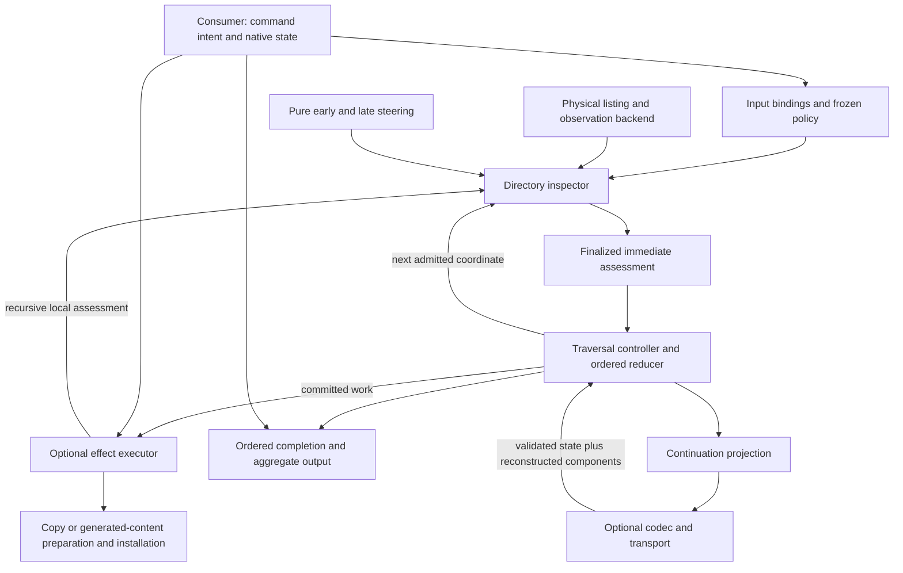

# Directory-local assessment, ordered traversal, and owned effects

The architecture centers on **one immediate-directory assessment boundary**, with
separate owners for recursive control and filesystem effects. A caller can inspect
one directory, drive a recursive comparison, perform recursive synchronization, or
retain an explicit continuation. These operations share observation and steering
semantics; they need not share one traversal policy or one persisted representation.

This is a proposed architectural statement. The existing specifications remain
authoritative until amended. Sections 1–8 state responsibilities and intended
contracts; section 9 distinguishes delivered mechanisms from extensions. The
[brief](/design/roadmap/brief0.gpt6a.md) supplies the constraints: a good source,
out-of-band concurrency/locking, and no recovery, rollback or effects-history
promise. Retry/skip continuation is a control capability within those constraints.

## 1. Component graph



The arrows distinguish four flows:

- **Information:** names, presence and early hints → full admitted facts → baseline
  comparisons → finalized local work. Facts remain immutable under policy.
- **Control:** admission and final actions → permitted child visits, ordered
  delivery, effect dispatch, completion and pause. Only the controller advances
  the committed traversal position.
- **Effects/data:** an executor obtains source bytes or generated content and
  installs/removes names. Neither an observation nor a visitor invocation is a
  completed effect.
- **Continuation:** the controller projects enough semantic state to resume future
  work. It does not serialize open files, callbacks, staging leases or a history
  of already-performed effects.

The read-only core owns inspection and comparison traversal. The optional sync
crate owns filesystem mutation. Consumers own repository semantics, command
selection and output delivery. A continuation/codec must not invert those
dependencies by making ordinary inspection depend on serialization.

## 2. Components and their interfaces

| Component | Inputs and output | Ownership |
|---|---|---|
| Binding | Physical roots, logical coordinates, root shape and operation intent → validated operation context | Caller chooses inputs; binding checks structural requirements. A missing source is not deletion authority. |
| Listing/observation backend | A present physical directory → immediate native names and cached hints; admitted names → no-follow facts and needed literal links | Owns ephemeral directory handles and platform details. Never chooses consumer scope or traversal order. |
| Directory inspector | Present/absent sides, logical containing coordinate, purpose, visitor → immutable immediate assessment or error | Owns union ordering, baseline comparison, proposal construction and final validation. Does no mutation or recursive descent. |
| Pure steering | Frozen consumer facts plus early names or completed local observations → admission/actions/refusal | Chooses only authorized decisions. Does not perform I/O or advance continuation. |
| Traversal controller | Assessment results and recursion policy → next coordinates, ordered delivery and aggregate completion | Owns active frames, child positions, coverage and speculative commitment. |
| Effect executor | Finalized work plus current bindings/content suppliers → effects and outcome | Owns physical writes, temporary preparation, resources and joined effect completion. |
| Ordered completion handler | Completed controller unit and aggregate → report or generated logical output | Runs at an ordered boundary, not as a speculative visitor side effect. |
| Continuation codec/transport | Explicit controller state ↔ validated persisted data | Owns encoding and publication, not tree semantics or recovery. |
| Consumer adapter | Native repository/configuration intent → bindings, frozen policy and executor selection | Owns JJ/Git state, source selection, mapping intent and externally meaningful success. |

These are responsibility boundaries, not a demand for eight new traits or crates.
Existing concrete functions and statically dispatched visitors should remain usable.
Introduce a generic interface only where a second concrete composition needs it.

The implemented local interface is `inspect_directory` in
[`src/visitor.rs`](/src/visitor.rs): logical source/target roots and `dir`, optional
physical containing directories, `Purpose`, and `&Visitor` produce `DirectoryPlan`.
Its caller validates admitted routing ancestors. It is a low-level read-only seam,
not a self-contained root-confinement or recursive synchronization API.

## 3. Physical input, logical input, and actions

### Coordinates

Maintain the distinction among:

1. **Logical coordinate:** the name whose presence, policy and result the consumer
   is reasoning about.
2. **Physical source coordinate:** where an observation or content read occurs.
3. **Physical target coordinate:** where existing state is observed or an effect
   will be installed.
4. **Private preparation coordinate:** executor-owned staging, never substituted
   into consumer policy as the logical destination.

Ordinary directory work uses the same root-relative suffix on both sides. A
leaf-to-directory replacement already needs different logical and physical output
locations during preparation. That is an architectural reason to keep coordinates
separate, without claiming a general mapping engine already exists.

Pair-wide preservation keeps presence intact. A hidden source entry does not
become target-only. A present entry with unknown cached kind does not become absent.
These invariants belong at the inspector boundary, independently of the chosen
name/path storage representation.

### Logical outputs and generated content

A logical output such as a generated `summary.txt` need not correspond to an
observed source file. It must not acquire invented `std::fs::Metadata` merely to
fit the physical inspector. The cursor example demonstrates the smaller useful
composition: finish assessment, generate bytes from accumulated state, and return
a logical file value to its consumer.

If generated content is to be installed, the effect interface needs an explicit
content input and destination/collision semantics. That can begin as an ordered
consumer operation using the shared installation machinery. Whether it later
belongs in a unified action representation or in a logical-input adapter remains
open. Neither placement follows merely from wanting generated files.

Existing `Action` edits are sufficient for keep/install/remove decisions on
observed slots. They do not inject names, remap slots, force-install equal leaves,
or carry generated bytes. Parameters already exist in different owners: copy
policy in `Applier`, frozen values in a visitor, and generator parameters in the
cursor descriptor. A universal action registry is not required to express those
three cases.

## 4. Directory-local assessment and recursive surfaces

The local sequence is:

```text
list present sides → sort/merge native names → early admission
→ complete admitted facts → baseline comparison/proposals
→ late steering → validate the whole immediate batch → publish
```

Inspection is read-only, but filesystem observation itself is not referentially
pure. **The policy decisions are pure over supplied/frozen facts.** They can run
speculatively, repeat, or be discarded. Ordered printing, generation with mutable
accumulators, process execution and writes belong downstream of commitment.

A local batch includes clean leaves and directory descent decisions. Failed local
assessment publishes no partial comparison/count contribution. Its established
error order is listing, early, admitted observation in native-name/source-first
order, late, validation. Structural-root observations necessarily precede early
steering of a root singleton.

Three recursive surfaces compose that local unit:

| Surface | Recursion and result |
|---|---|
| Paired comparison | Descend finalized admitted paired directories. One-sided directories are opaque comparison units. Yield observed divergent batches; summarize the committed prefix. |
| Recursive effects / joint preview | Follow finalized actions through source-only copies, target-only removal and coupled replacements as well as paired work. Preview predicts work without performing effects. |
| Assessment cursor | Choose an explicit assessment coverage policy, retain active frames, and expose ordered completion. The current example examines one-sided interiors and directory sides of collisions too. |

One controller must own each recursive edge in a composition. In current `run`,
the paired walker owns matched-directory descent, while the executor owns opaque
one-sided interiors. `Context::execute_entry`'s `recurse_pairs` parameter enforces
that division. A future cursor driving all recursive work must transfer that
ownership deliberately rather than letting both cursor and applier revisit it.

Assessing the directory side of a collision does not split its coupled mutation
authorization. Removing a target directory to install a source leaf still depends
on its retained descendants; a directory-local declaration is not proof that all
descendant effects are permissible.

### Where whole/subtree knowledge saves work

- Early preservation skips child metadata and recursive entry, after the containing
  directory has been listed. Late preservation skips descent/effects but has already
  paid observation costs.
- An opaque source-only directory saves **comparison** descent. Recursive copy still
  enumerates its contents and applies policy; opaque does not mean one syscall.
- A trusted known-leaf list can avoid discovery of unrelated source directories.
  `seed_leaves` demonstrates this separate surface, with its own absence contract.
- Whole-subtree equality or replacement knowledge may justify less assessment,
  but its scope must include the actual comparison/effect domain. JJ tracked-tree
  equality alone says nothing about ignored payload. Directory mtime is never a
  recursive equality proof.

Any new shortcut must say whether it saves assessment, enumeration, transfer or
only reporting. It must preserve required descendant policy and report skipped
coverage honestly; preservation is not evidence of equality.

## 5. Ordering, execution and pause boundaries

The controller is the authority for deterministic DFS commitment. Optional
parallel inspection can prepare independent permitted directory results ahead
of that position, but only the ordered reducer changes committed coverage.
Started work joins before control returns. Caller-owned pools and bounded
directory lookahead remain execution policy, not persisted identities.

At a work-bearing directory, descendants affected by that work remain sealed
until its effect boundary has finished and the caller advances. Today divergence
is a sufficient trigger because equal leaves cannot gain new work. **If actions
can generate work in an otherwise clean directory, publication and sealing must
be based on executable work/control dependency as well as observed divergence.**
Changing only the action enum would lose such work: `Roots::inspect_visitor`
currently drops clean plans, and both walkers publish on `!diff.is_empty()`.

For a composable assessment cursor, use the following normal pause boundary:

> One attempted immediate-directory assessment returns; success records its local
> reduction and selected children, or failure retains the pending tip. No listing
> handle or active visitor call remains. Ready postorder completions can drain
> without another filesystem assessment.

This matches the current example and gives clean/empty directories observable
progress. A divergent-record `Iterator::next()` is not that boundary: it can
internally traverse arbitrarily many clean directories before returning.

For effectful continuation, first permit pauses only **between joined effect
units**, after temporary preparation and permission leases are settled. A whole
recursive one-sided operation is a valid initial unit, but is not a bounded
directory step. Finer pauses require explicit recursive executor state—pending
container completion, retained-child outcomes, and remaining work—not merely
serialization of the paired walk. The appropriate granularity remains open.
Pausing in a live staging/permission scope is not part of this proposal.

## 6. State ownership and continuation construction

| Lifetime / owner | State | Continuation treatment |
|---|---|---|
| Consumer/binding | Roots, selected operation, frozen policy inputs, content providers and resource choices | Save necessary descriptors/parameters or require explicit reconstruction. |
| Inspector | Listing storage, directory handles, temporary union, full metadata/link facts | Finish/drop at pause. Do not archive backend handles or treat observations as lasting authorization. |
| Finalized local batch | Observed classification, admitted actions and local facts | Reduce to necessary traversal/work state; fresh effect assessment may be needed on resume. |
| Controller | Active coordinates, pending children, positions, phases, aggregates and incomplete coverage | This is the principal serializable continuation. |
| Parallel execution | Jobs, ready speculative results, locks and pool reference | Join at pause; semantic need for retaining ready results is a separate decision. |
| Executor | Source/output handles, staging, writable leases, in-flight sibling work | Settle at supported pause; effects already done remain filesystem state. |
| Ordered output | Generated bodies/events for this invocation | Deliver to caller; no retained output history is required. |

Construct a cursor from **bindings + inspector/policy + recursion/reduction
behavior + optional ordered handler + initial or restored controller state**.
These are roles; the Rust constructor/generic layout and archive schema are still
design choices. An assessment-only composition needs no filesystem executor.
An ordinary in-memory cursor needs no codec. A codec reconstructs data, while
application code reconstructs executable components and validates compatibility.

The current example's `directory-summary/v1` descriptor is one workable dispatch
pattern, not a mandate for all components to become a string-keyed registry.
Closures or borrowed resources need not be serializable; a resumable composition
must instead explain how the receiver supplies equivalent behavior.

Retry retains a failed pending unit for another attempt. Skip consumes that unit
and immediately marks affected ancestor coverage incomplete. Already assessed
ancestors need not be relisted, so continuation is not a fresh scan after edits.
For effects, retry must re-establish what current filesystem state requires;
replaying an old `DirectoryPlan` is not the mechanism. Neither retry nor cursor
publication promises exactly-once output/effects, rollback, crash recovery or
an effects ledger. Aggregate progress counters are not such a ledger.

Borrowed native names can reduce transient allocation within inspector-owned
storage. Retaining children past that storage's lifetime requires ownership or
retention of the backing allocation. That constraint survives any layout choice;
the architecture does not select unsafe borrowing, arena offsets or an archive
representation before their costs and lifetimes are established.

## 7. A concrete composition

For an ordinary pair containing matched `src/`, source-only `cache/`, and a
target-only `local/`:

1. Bind real roots. A consumer chooses a visitor preserving `local` early.
2. Inspect the root once. `local` is preserved pair-wide; `src` becomes an admitted
   paired child; `cache` gets a create-and-descend action.
3. A comparison-only driver reports `cache` as one added directory and descends
   `src`. It does not claim to have inspected `cache`'s contents.
4. A sync driver executes `cache` through recursive local batches, then advances
   paired traversal. Logical names stay `cache/...` during any private preparation.
5. An assessment cursor can instead schedule `cache` as a source-only tip, retain
   its child list at a pause, and generate a summary at postorder completion.
   Generating that summary does not mutate either tree.

These are useful compositions of shared assessment, not mode flags claiming all
three operations have the same coverage or effect contract.

## 8. Library versus JW consumer

JW owns the choice of source, native workspace identity, revision transitions,
administrative state and command defaults. The normal source for the requested
work is the **JJ archive**, per the brief; a registered workspace source is an
additional case. Generic roots do not erase their native differences.

The adapter must distinguish ordinary transferable contents from repository and
working-copy administration. `.jj/repo`, checkout identity, file-state caches and
Git linkage have native semantics. Root-relative byte copying does not confer
workspace registration or prove cache validity. Those decisions stay outside
generic visitors and executors, with native operations ordered by the consumer.

`Auxiliary` in JW's [`cow/transfer.rs`](file:///home/rektide/src/jj-waltz/src/cow/transfer.rs)
shows the useful existing boundary: frozen selected roots/routes/device facts
steer the shared inspector, and a command-owned pool is lent to sync. Its legacy
selection is an implementation fact, not the architecture's required future
selection policy. Native process queries do not belong inside speculative hooks.

Default-on Git colocation with opt-out is the human-preferred product outcome.
Feasibility is unresolved here. Current `CreationMode::resolve` in
[`lifecycle.rs`](file:///home/rektide/src/jj-waltz/src/lifecycle.rs) explicitly
rejects combined colocation and CoW selections. That is evidence of a present
consumer restriction, **not proof of native impossibility**. Native archive versus
registered-workspace layout and creation experiments must decide which metadata
is created, retained, transformed or copied. This statement selects no transplant
protocol and introduces no rollback requirement to support one.

## 9. Implementation ledger and open intersections

### Delivered foundations

| Foundation | Inspected source / standing |
|---|---|
| Private physical observation and immutable facts | `listing.rs::Entry`, `visitor.rs::inspect_listed`; implemented, with owned names and backend handles dropped before late publication. |
| Directory-local physical/logical separation | `visitor.rs::inspect_directory`; implemented for actual directory observations, not a general virtual tree provider. |
| Pure steering and validated actions | `visitor.rs::finish`; specification defines purity, source implements action validation. Compatibility projections and Seed/Update/Prune live in `sync/src/visitor.rs`. |
| Ordered comparison and speculative separation | `walk.rs::PlanWalk::advance`, `frontier.rs::{next_finalized,reduce,begin_epoch}`; implemented divergent-only publication, joined epochs and seals. |
| Paired versus recursive effect ownership | `sync/src/lib.rs::Applier::run`, `apply.rs::{execute_entry,copy_directory_selected,reconcile_directory}`; implemented, not externally resumable within recursive application. |
| Public plans are not replay authority | `apply.rs::{apply_plan,apply_public}`; implemented fresh binding/policy observation and projection validation. Internal `apply_plan_with` reuses immediate facts. |
| Explicit continuation and generated logical output | `examples/cursor/src/cursor.rs::{Cursor,Frame,Tip,Descriptor,reduce}`; implemented isolated assessment specimen. It uses `NoVisitor`, Unix native bytes and coincident coordinates; no generic mapping/effect driver. |
| Codec evidence | [Prior cursor report](/design/cursor/implementation0.gpt61sxh.md) reports twelve focused tests and actual kopacetic snapshots. This commission did not rerun them or inspect codec internals. |

The older [flow](/design/execution/flow0.gpt6a.md) and
[state](/design/execution/state0.gpt6a.md) accounts explain these delivered
mechanisms in more detail. This statement adds intended compositional boundaries;
it does not promote every proposed extension to an implemented contract.

### Decisions still open, with discriminating next investigations

1. **General cursor surface and recursion ownership.** Sketch two concrete clients:
   the current all-directory assessor and a sync driver paused after a source-only
   directory. Identify which child scheduling/state can be shared without giving
   two layers ownership of descent. Decide the public step outcome before choosing
   a grand controller trait hierarchy.
2. **Effectful pause granularity.** Use a tiny source-only nested tree and a retained
   target-only child. Enumerate states needed to pause between child batches and
   finish containers correctly. Compare this with the simpler joined whole-unit
   pause. Do not introduce a journal to make the smaller unit look transactional.
3. **Generated work and ordered publication.** Trace one generated install in an
   otherwise equal directory. It must reach ordered execution and seal dependent
   descent even with an empty baseline diff. Decide a content input and collision
   rule before extending `Action`; retain ordinary divergent-only comparison as a
   useful projection.
4. **Mappings.** Specify one noncoincident source/destination case, including two
   inputs mapping to the same target name. Decide collision authority and ordering
   before treating separate coordinate fields as a complete mapping mechanism.
5. **Continuation representation.** Establish which state must survive for the two
   clients above, then compare borrowed runtime storage with owned continuation
   projection. Measure allocation/layout separately from codec overhead; an archive
   cannot borrow a closed directory stream.
6. **Subtree knowledge.** Present one actual trusted assertion and name its domain
   (tracked tree, ordinary contents, or selected payload). Show exactly which
   listing/assessment/effect steps it removes while respecting descendant policy.
7. **Native JW composition.** Independently test minimal archive-source and
   registered-workspace-source creation with colocation and opt-out. Record native
   versions, actual `.jj`/`.git` layouts and cache/registration ownership. Feed the
   findings into the consumer adapter, rather than encoding an assumed metadata
   layout in generic tree operations.

These intersections are bounded follow-on decisions. The component ownership can
be adopted without settling every action representation, codec, mapping or native
workspace protocol at once.
