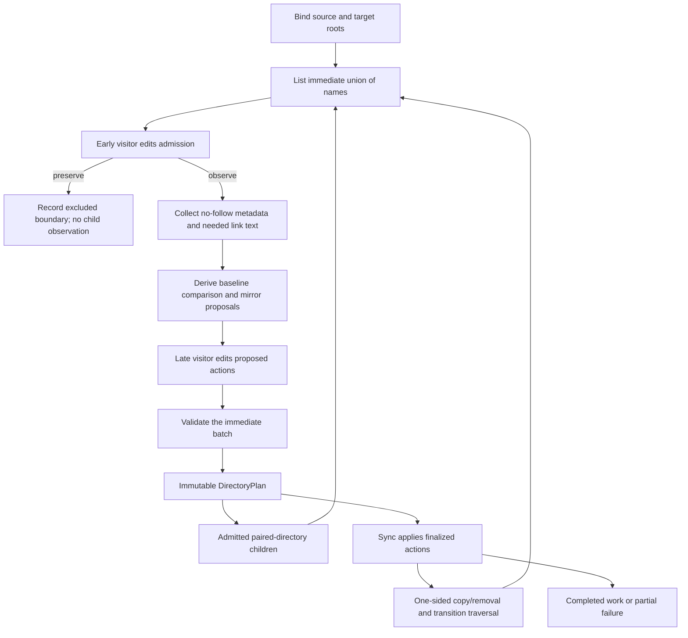

# Net execution flow

**The ordinary library path is: list names → early visitor → observe admitted
entries → propose work → late visitor → validate → apply and descend.**

This report walks the implementation. The companion
[context and donor-state report](state0.gpt6a.md) explains what each arrow carries,
who owns it, and how long it lives.

Source coordinates: diffdirs `0ce979c26a323ac2172215c4b32a09b3e9a86b5d`;
JW `24b58a67d0047e27c4a8479686e00d0ebffb8515`. The native
[library specification](../../README.md) and [sync specification](../../sync/README.md)
own the contracts. This is a source-reading account, not a new benchmark or a
claim that every proposed JW behavior has shipped.

## 1. Library: the three flows

There are three related flows, not just a list of changed files:

1. **Information:** actual names and presence become metadata observations and
   baseline comparisons. Visitors cannot change those facts.
2. **Control:** visitors edit admission and proposed actions. Final actions decide
   both filesystem mutation and which descendants may be visited.
3. **File data:** when an installation is necessary, the applier opens the source
   and prepares a destination file/link. File contents are not carried through
   the visitor contexts or public diff records.



The arrows back to listing describe reuse of the inspection/visitor mechanism.
They do not mean every branch goes through the same paired-directory iterator.

### 1.1 Library: bind the roots and choose an operation

Typical entry:

```rust,ignore
let transfer = diff_dirs_sync::Applier::new(
    source,
    target,
    diff_dirs_sync::CopyPolicy::ReflinkRequired,
)?
.visitor(my_visitor);

let report = transfer.run()?;
```

`Applier` binds canonical root paths and checks real ancestors and root separation.
The source must be a real directory. A missing target is allowed for initialization;
an existing target file/link needs the explicit replacing-root constructor.
Binding performs no copy, staging or reflink capability probe.

`run()` first dispatches root shape:

- **Both directories:** use a visitor-steered paired walk.
- **Missing target:** inspect the root singleton and initialize through recursive
  source-only application.
- **Target leaf, explicitly authorized:** inspect the root singleton and stage a
  directory replacement, or retain it if the visitor selects that outcome.
- **Missing source:** error; it is not interpreted as an empty deletion source.

Root structural observations are a deliberate exception to “early before
metadata.” They are needed to bind the operation. An early-preserved child such
as `.jj` receives no child metadata lookup; preserving the root suppresses its
contents, not mandatory root validation.

### 1.2 Library: list, merge, and visit names

`inspect_directory_execution` reads the immediate source and target directory
listings. A recursive one-sided operation supplies only its existing side. The
library sorts the union by native name bytes and knows presence before metadata:
`SourceOnly`, `Both`, or `TargetOnly`.

The early visitor receives `Names`:

- logical containing directory and root/singleton indication;
- immutable names and side presence;
- mutable admission, initially `Observe` for every slot.

Calling `preserve_tree()` suppresses **both sides** and all descendants. It does
not erase a source fact and manufacture target-only deletion authority. Returning
a refusal stops this batch before child observation or publication.

The implementation retains private `DirEntry` handles through early admission.
Excluded handles are dropped uninspected. Admitted entries use
`DirEntry::metadata()`—no-follow metadata, with the directory-relative path available
on the configured Linux implementation. The handles do not become persistent
plans or a donor catalog.

Directory enumeration can already return type/inode facts. Current `Names` exposes
only names/presence, but that is an API limitation, not an OS requirement. The
[state report's dirent clarification](state0.gpt6a.md#enumeration-can-already-provide-facts)
explains the proposed early exposure of available hints and why an unknown-type
fallback must not silently perform a stat before early filtering.

### 1.3 Library: observe and propose

For each admitted union name, source facts are obtained before target facts.
Facts include metadata and literal link text where the operation needs it.
Target-only deletion does not read a link merely to populate a callback.
Regular-file contents are not hashed to compare them.

An error obtaining required observations aborts the batch. Late is not called
with invented facts to stand in for a failed metadata/readlink operation; that
is another reason to use early preservation when an entry must not be inspected.

The default proposals are:

| Observed shape | Baseline proposal |
| --- | --- |
| Source-only regular file/link | `InstallLeaf` |
| Both supported leaves, different comparison keys | `InstallLeaf` |
| Both supported leaves, equal keys | `KeepLeaf` |
| Target-only regular file/link | `RemoveLeaf` |
| Source-only directory | `Directory { Create, descend: true }` |
| Both directories | `Directory { Keep, descend: true }` |
| Target-only directory | `Directory { Remove, descend: true }` |
| Source leaf / target directory | `ReplaceWithLeaf` |
| Source directory / target leaf | `ReplaceWithDirectory { descend: true }` |
| Unsupported kind on either side | No supported comparison or proposal yet |

“Different” uses regular-file type/size/exact mtime and literal symlink text.
Matched directories have no immediate stat-based difference; their children can
differ. Directory mtimes never permit subtree pruning. Mode-only changes and
byte edits preserving size/mtime are outside the comparison contract.

### 1.4 Library: late steering and finalization

Late receives `Operations`, including clean leaves and directory descent. Each
`Operation` exposes immutable facts, presence, baseline comparison and baseline
action, plus an editable current action.

The visitor can retain a leaf, preserve an entire subtree, keep a directory while
visiting its children, or select another legal operation. A type replacement is
coupled; it cannot be split into an unrelated delete-half and create-half.
Unsupported children can be explicitly preserved late, after their metadata was
observed. Their comparison remains unknown; they are not fictitious file changes.
Otherwise they are refused. Unsupported structural roots remain errors.

After the callback, the library validates the **whole immediate batch**. Names
cannot be invented/reordered and an action must fit actual presence/types. For
example, it cannot remove a source-present leaf as though it were an extra, or
admit writes beneath an absent directory whose creation was refused. Equal-leaf
force installation is currently unsupported.

The result is an immutable `DirectoryPlan` with:

- finalized observations/actions;
- baseline `DirDiff` for admitted, supported comparisons;
- exclusion, retention and proposed-work accounting.

The baseline diff is not rewritten when late suppresses an installation. A changed
file can remain in `diff.files.changed` while its final action is `KeepLeaf`.

### 1.5 Library: commit traversal and hand off work

The paired walker derives pending children from **final actions**, not from the
original directory listing. Only admitted, descending, both-sided directories
become paired child jobs.

`PlanWalk` invokes late even for clean directories, but yields plans only at
directories with an observed supported divergence. This is sufficient for the
current action vocabulary: a clean leaf cannot be force-installed, while a clean
directory's descent can be stopped internally without publishing a write batch.
The legacy `walk()` projects each yielded plan to its baseline `DirDiff`.

`Applier::run()` consumes each yielded plan, completes its application, then asks
for the next plan. Its internal `apply_plan_with` uses the just-observed facts;
it does not rediscover the directory merely to run visitors again.

The public `apply_plan()` boundary is different: it checks bound roots and routing
ancestors, obtains fresh observations under the receiving visitor, and compares
the supplied plan's projection with the fresh result. It executes fresh facts.
That is not byte-for-byte validation of all old metadata and not a replay API for
stale filesystem plans.

### 1.6 Library: recursive application closes the one-sided gap

The paired walker does not inspect the interior of an opaque added/removed
directory. The sync kernel does, through the same early/late mechanism:

- **Source-only directory:** create the admitted container, list source children,
  call early, observe, call late, validate and apply that child batch.
- **Target-only directory:** list target children and steer their removal or
  retention. Remove the container only if authorized and no retained descendant
  requires it. Permission changes are deferred until actual mutation needs them.
- **Matched directory:** the main paired walker normally owns its descent. The
  applier does not duplicate that recursion after applying the parent's record.
- **Leaf → directory:** prepare the selected source subtree privately. Visitors
  see logical final paths, not temporary staging paths. Install only after
  preparation succeeds.
- **Directory → leaf:** inspect removability of that affected target subtree
  first. A preserved/retained descendant blocks replacement before dismantling
  it. This exceptional case pays an additional local traversal; ordinary execution
  does not pre-audit the whole tree.

These are the loops that ensure early exclusion and late action edits apply to
one-sided descendants as well as paired comparison. The library does not hand an
opaque directory to an unfiltered recursive delete.

### 1.7 Library: bytes, staging and final effects

For an installed regular file on Linux, the kernel opens the source and a private
target-side output, then uses the chosen copy policy. `ReflinkRequired` invokes
`FICLONE` on held descriptors; failure is an error. Ordinary `Copy` uses `io::copy`;
`ReflinkOrCopy` permits its documented fallback. A reflink shares extents while
creating a separate file inode; it is not a hard link.

The applier sets permissions and exact supported mtime, checks timestamp readback,
then renames the staged leaf into its final name. Source/output handles remain
usable through preparation. Symlinks are recreated from literal link text and
are never followed. A staging arena and writable-directory lease are shared by
the relevant parent batch, created only when needed.

For retention or already-satisfied data there is no staging or namespace/chmod
write. Failed private preparation is cleaned as library-owned data, separately
from the visitor policy for user data. Once permitted removals or earlier batches
have completed, an error does not roll them back.

### 1.8 Library: parallel ordering and reports

With the borrowed-pool API, directory inspections can run ahead of the ordered
cursor. Both visitors run in the inspection job, outside the frontier lock,
before child admission. A differing directory seals its paired descendants until
its plan has been delivered and the consumer advances after application.

Every comparison epoch joins before returning a plan/error/`None`; application
also joins its started work. Only the ordered committed prefix contributes to
the comparison summary. Side effects of a parallel apply are not a promised
serial prefix. J/K bound directory jobs/lookahead, not bytes or all recursive
application work.

The final report keeps four things separate:

1. **Observed:** admitted baseline comparison and committed coverage.
2. **Planned:** immediate finalized namespace-action counts, not byte counts.
3. **Policy:** successful exhaustion, retention and exclusions.
4. **Completed:** actual installations, removals and permission operations.

Source-only recursive work has its own planned/completed counts; it is not all
enumerated by a single `dirs.added` observation. Excluded or retained coverage
does not certify full-root equality. Failure carries actual partial progress,
the comparison prefix where available, and underlying/restoration errors.

## 2. Example consumer: a small generic mirror

This is an explanatory consumer, **not JW configuration or a selected JW default**.
It preserves `.local` subtrees early, and keeps a newer destination regular file
late. All other entries follow the ordinary mirror proposals.

```rust
use diff_dirs::{Action, CheckError, Names, Operations, Visitor};
use diff_dirs_sync::{Applier, CopyPolicy};
use std::path::Path;

struct KeepLocal;

impl Visitor for KeepLocal {
    fn early(&self, batch: &mut Names) -> Result<(), CheckError> {
        for name in batch.entries_mut() {
            if name.name() == ".local" {
                name.preserve_tree();
            }
        }
        Ok(())
    }

    fn late(&self, batch: &mut Operations) -> Result<(), CheckError> {
        for entry in batch.entries_mut() {
            let keep = match (entry.source(), entry.target()) {
                (Some(source), Some(target))
                    if source.metadata().is_file() && target.metadata().is_file() =>
                {
                    target.metadata().modified()? > source.metadata().modified()?
                }
                _ => false,
            };
            if keep {
                entry.set_action(Action::KeepLeaf);
            }
        }
        Ok(())
    }
}

fn synchronize(source: &Path, target: &Path)
    -> Result<diff_dirs_sync::Report, diff_dirs_sync::Failure>
{
    Applier::new(source, target, CopyPolicy::ReflinkRequired)?
        .visitor(KeepLocal)
        .run()
}
```

The example is API-shaped documentation, not an executed fixture in this report.

### 2.1 Example consumer: walk one operation

Assume both bound roots are directories and the stated timestamp relationships
are already true:

| Logical path | Input fact | Early | Late/final work |
| --- | --- | --- | --- |
| `.local/notes` | Exists only at target | Preserve `.local`; never inspect `notes` | No operation |
| `src/unchanged` | Both files have equal comparison keys | Observe | `KeepLeaf` |
| `src/new` | Source-only file | Observe | `InstallLeaf` |
| `src/edit` | Different files; target older | Observe | `InstallLeaf` |
| `src/newer-local` | Target regular file has newer mtime | Observe | Baseline install becomes `KeepLeaf` |
| `newdir/item` | Source-only directory and file | Observe `newdir`, then its child batch | Create directory and install child |
| `obsolete/stale` | Target-only file below target-only directory | Observe | Remove leaf |
| `obsolete/.local/notes` | Target-only preserved descendant | Preserve `.local` in recursive removal | Keep `.local` and necessary `obsolete` container |

The `src` pair is revisited by the paired walker. `newdir` and `obsolete` interiors
are visited by recursive application. All three routes invoke the same consumer.
The resulting filesystem is policy-satisfied, but not an exact full-root mirror:
newer target content and preserved local data intentionally remain.

If source `obsolete` were instead a file while the target retained
`obsolete/.local/notes`, the coupled replacement would be refused by the local
removability check. It would not delete the local notes to make the file fit.
Earlier unrelated batches could still have completed.

## 3. JW specifically: the current consumer execution

JW is not the generic example above. At the inspected revision it still uses
`copy_ignored` as a compatibility selection and still runs the existing JJ
sparse-prefill protocol. The visitor integration changes the filesystem mechanism;
it does not select a new broad-copy default or install production cache adoption.

### 3.1 JW specifically: establish command inputs

`reseed::engine::run_inner` resolves workspace registrations, the donor and desired
revision, configuration and selected targets. It acquires JW's advisory operation
lock, checks ownership/full-sparse/stale/conflict conditions and captures Linux
mount topology before traversing the data regions.

It snapshots/verifies the source tracked tree, then snapshots target work and
captures a shared operation coordinate. Existing source/desired tracked inventories,
bookmark coverage, root identities and future link/obstruction facts become the
per-target `Plan`. [JW state](state0.gpt6a.md#4-jw-specifically-command-state-and-donor-state)
explains why these are not an immutable filesystem snapshot.

### 3.2 JW specifically: selection still precedes transfer

The compatibility path compiles the effective `copy_ignored` patterns, constructs
or reuses frozen native ignore contexts, and runs `payload::select_outside`.
This fuses donor selected-root discovery with validation outside selected payload
interiors. The native Git oracle answers eligible-root questions here, **not inside
diffdirs visitor calls**.

For each target, JW checks desired-tree ignore eligibility and tracked disjointness,
validates retained/outside regions, checks obstructions/links/bookmarks, and plans
which equal tracked paths it can clone. These passes still exist. The current
visitor slice is not a completed removal of all legacy selection/validation work.

### 3.3 JW specifically: tracked refill

For each admitted target, `execute` presently performs:

1. Recheck identities, source tracked state and target readiness/bookmark coverage.
2. `jj sparse set --clear`: clear tracked materialization while retaining the root
   and `.jj`.
3. Remove residual recorded old/desired **leaves**, not arbitrary subtrees.
4. `jj new D` under empty sparse patterns. This creates an empty **change containing
   D's file tree**, not an empty file tree.
5. If explicitly requested, clear remaining content through `clear_with_visitor`
   and `WorkspaceClear`, preserving the target's root `.jj`.
6. Install equal source/desired tracked prefills through `cow::clone_files` →
   generic `seed_leaves`. The wrapper still checks listed source leaf eligibility;
   the shared installer performs its own current observations and grouped installs.
7. `jj sparse reset`, followed by live tracked-tree verification. Missing tracked
   paths are materialized by JJ; prefilled paths can receive placeholder states
   whose later snapshot reconciliation reads/hashes their contents.

The listed-leaf installer is a separate known-input operation, not the general
early/late tree walk. It enumerates no unlisted donor directories and does not
copy native JJ metadata. Its current API uses `Check`, not the general visitor.

### 3.4 JW specifically: the root-bound visitor transfer

After tracked materialization, JW constructs `transfer::Auxiliary::legacy` from
the frozen selected roots and source/desired tracked inventories. The proof rejects
tracked overlap; the visitor stores selected roots, their routing ancestors,
source/target device values and a creation-mode flag—not every tracked path.

The actual call is a workspace-root binding, approximately:

```rust,ignore
Applier::new_checked(source_root, target_root, ReflinkRequired, guard.borrowed())?
    .visitor(auxiliary)
    .run()?;
```

`Execution` substitutes `run_in_pool` for the experimental `payload-parallel`
build, sharing one command-owned pool capped at four available workers, J matching
workers and K=256. Serial remains default. JJ commands and `Rc` rule contexts stay
on the caller thread.

**Early:** outside selected roots and their routing ancestors, preserve the entire
name pair. This includes root `.jj` and other unselected local/recorded contents.
Administrative names encountered *inside* selected data are refused.

**Late:** validate already-observed devices and selected source-root types. For
routing directories, keep existing containers or create missing ones, and descend.
Refuse routing leaf collisions rather than replacing unrelated local data. Inside
selected roots, leave the default mirror actions in place. The compatibility
`Guard` also checks participating entry types and collects rare absolute-source-link
diagnostics from supplied facts.

For example, a frozen selection `packages/a/cache` admits the `packages` and `a`
routing directories but early-preserves `packages/a/src` and `packages/a/local`.
The selected cache's one-sided children still get visitor-controlled copy/removal.
An empty or disabled selection authorizes no auxiliary copying.

### 3.5 JW specifically: finish, preview, creation and prepare

After auxiliary reconciliation, JW rechecks the donor, applies configured links,
then verifies the target tracked tree, full sparse state, identities and exact
desired parent relationship. Its source verification currently occurs at several
barriers; this report does not imply a single verified donor snapshot reused
without those calls.

JW dry-run uses **joint `preview()`** with the actual visitor, alongside native
planning checks. It can discover routing/type conflicts without applying data.
Normal execution does not run that preview first. Dry-run can still perform JJ
snapshots according to JW's native planning contract; it is not an entirely
read-only command.

New-workspace auxiliary creation uses the same root visitor with `new_targets_only`,
which refuses an occupied selected root. Its current path still has a capability
probe and its own admission checks. Existing workspace switches do not refill.
Source-only `prepare` remains separate: it may run its configured source commands
and validates across their boundaries; it does not transfer worker contents.

Production reseed does **not** copy donor `tree_state`. A small existing-workspace
test demonstrates that possibility; [the separate state report](state0.gpt6a.md#5-jw-specifically-native-jj-state-and-the-adoption-test)
keeps that evidence distinct from the running protocol.

## 4. Reading the net effect correctly

At library level, a path only reaches mutation after name admission, observation,
late steering and action validation. The consumer sees the same logical names
during recursive/staged work. Reports distinguish what was seen, proposed and done.

At JW level, that kernel is embedded between JJ tracked materialization and final
JJ/link verification. It shares filesystem operations and makes the selected
auxiliary behavior visitor-driven. It has **not** removed all selection work,
all tracked refill work, or resolved which ordinary contents a future JW command
should mirror. Those are separate from explaining the execution that exists now.

## 5. Source navigation

### Library source

| Follow this step | Native owner |
| --- | --- |
| Bind and run | [`Applier` in sync/src/lib.rs](../../sync/src/lib.rs), [root/path validation](../../sync/src/paths.rs) |
| Build both contexts and finalize | [`inspect_directory_execution`, `operation`, `finish` in src/visitor.rs](../../src/visitor.rs) |
| Lower children and yield | [`Roots::inspect_visitor`](../../src/pair.rs), [`PlanWalk`](../../src/walk.rs), [parallel frontier](../../src/frontier.rs) |
| Apply and recurse | [`apply_plan_with`, `execute_batch`, `execute_entry`, `reconcile_directory` in sync/src/apply.rs](../../sync/src/apply.rs) |
| Stage/copy/install, seed and clear | [`prepare_file`, `copy_leaf_with`, `seed_leaves`, `clear_with_visitor`](../../sync/src/apply.rs) |
| Interpret results | [Core Summary](../../src/model.rs), [sync Report/Failure](../../sync/src/model.rs) |

### JW source

| Follow this step | Native owner |
| --- | --- |
| Plan and execute a reseed | [`run_inner`, `execute`](file:///home/rektide/src/jj-waltz/src/reseed/engine.rs) |
| Frozen ignore inputs | [`FrozenRules`, `IgnoreRules`, `Oracle`](file:///home/rektide/src/jj-waltz/src/cow/payload.rs) |
| Current selection/outside traversal | [`select_outside`, `outside`](file:///home/rektide/src/jj-waltz/src/reseed/payload.rs) |
| Runtime early/late adapter and pool | [`Auxiliary`, `WorkspaceClear`, `Execution`](file:///home/rektide/src/jj-waltz/src/cow/transfer.rs) |
| Listed tracked prefills | [`clone_files`](file:///home/rektide/src/jj-waltz/src/cow.rs) |
| Creation-specific auxiliary path | [`IgnoredPlan`, `Proof::copy_to`](file:///home/rektide/src/jj-waltz/src/lifecycle/ignored.rs) |
